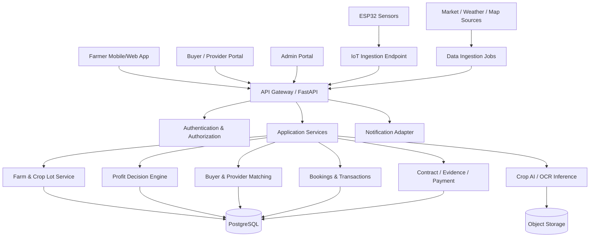

# 05 — Technical Architecture and Deployment Blueprint

## 5.1 Architecture objective

Build a modular but simple system that the team can complete and explain. Avoid microservices for a hackathon MVP. Use a modular monolith backend with clearly separated domains and a single relational database.

## 5.2 Recommended MVP stack

This is a recommendation, not a claim about what is already built. If the team has an existing working stack, preserve it unless migration has a clear benefit.

| Layer | Recommended choice | Why |
|---|---|---|
| Web frontend | React + Vite + TypeScript | Fast development, component ecosystem |
| UI styling | Tailwind CSS + a consistent component library | Responsive, consistent screens |
| Charts | Recharts or Chart.js | Profit comparisons and trends |
| Maps | Leaflet + OpenStreetMap | Map display without making Google Maps a mandatory dependency |
| Backend | Python FastAPI | Clear API contracts; convenient Python ML/OCR integration |
| Database | PostgreSQL | Relational transactions, constraints and reporting |
| ORM/migrations | SQLAlchemy + Alembic (or equivalent) | Structured data and schema versioning |
| Authentication | OTP provider or managed auth | Avoid custom insecure auth; demo auth must be labelled |
| ML inference | Python service/module | Reuse model ecosystem; keep model versions explicit |
| Image/file storage | S3-compatible object storage or managed storage | Store crop images and documents outside DB rows |
| IoT transport | HTTPS for simplest demo; MQTT if needed | Reliable device-to-server telemetry |
| Deployment | Vercel frontend + hosted API/database | Separate frontend and backend deployments |
| Version control | GitHub | Branches, issues and review |

## 5.3 High-level logical architecture



## 5.4 Frontend modules

Suggested routes:

- `/login`
- `/onboarding`
- `/dashboard`
- `/farm`
- `/harvest/new`
- `/harvest/:id`
- `/decisions/:lotId`
- `/buyers`
- `/offers/:id`
- `/execution/:decisionId`
- `/bookings`
- `/rescue/:lotId`
- `/transactions/:id`
- `/profit`
- `/crop-health`
- `/water`
- `/contracts`
- `/admin`

Suggested reusable components:
- `DataSourceBadge` (Live / Farmer input / Sensor / Estimate / Demo).
- `FreshnessLabel` (last updated timestamp).
- `ProfitBreakdown` (revenue and line-item costs).
- `FeasibilityStatus`.
- `OptionComparisonCard`.
- `RequiredActionList`.
- `OfferCard`.
- `BookingStatusTimeline`.
- `CropLotSummary`.
- `RiskFlag`.
- `EmptyState` and `OfflineState`.

## 5.5 Backend domain modules

```text
backend/
  app/
    main.py
    core/                 # config, security, logging, errors
    auth/                 # login, OTP verification, roles
    users/                # user and preferences
    farms/                # farms, resources, locations
    crop_lots/            # harvest lots, photos, inventory
    market_data/          # market sources, price observations
    buyers/               # buyer and processor profiles
    offers/               # offers, responses, expiry
    decision_engine/      # scenarios, calculations, ranking
    providers/            # transport, storage, equipment, labour
    bookings/             # service requests and confirmations
    rescue/               # urgent re-evaluation workflow
    transactions/         # delivery, invoice, payment, actual profit
    contracts/            # documents, OCR, clause flags
    crop_ai/              # model inference and versioning
    iot/                  # devices, telemetry, rules
    notifications/        # in-app/email/SMS adapters
    admin/                # moderation, data health
  migrations/
  tests/
  scripts/
```

## 5.6 Data flow and trust boundaries

- Browser/mobile client never connects directly to the database.
- All writes pass through authenticated backend endpoints.
- External data is ingested through adapters and normalized before use.
- Sensor devices authenticate separately from human users.
- Files are stored in object storage; database stores metadata and access references.
- AI output is stored with model version, confidence and input reference.
- Financial calculations are performed server-side and persisted with an input snapshot.
- Admin actions on offers, bookings and transactions are audited.

## 5.7 Authentication and authorization

Roles: `FARMER`, `BUYER`, `PROCESSOR`, `TRANSPORTER`, `RESOURCE_PROVIDER`, `FPO_MANAGER`, `ADMIN`.

Use role-based permissions plus ownership checks. A farmer can read/write their own farms, crop lots and transactions. A buyer can see only relevant enquiries/offers and data explicitly shared with them. An admin has operational permissions, but sensitive edits must be logged.

Security requirements:
- OTP expiry, rate limiting and attempt limits.
- Do not log OTPs, access tokens or sensitive documents.
- Store passwords only using a strong password hashing function if passwords are used.
- Validate uploaded file types and sizes.
- Use HTTPS in deployment.
- Protect against IDOR by checking record ownership on every request.
- Use environment variables/secrets management; never commit API keys.

## 5.8 Reliability and observability

Log structured events with request ID, user/role (non-sensitive identifier), module and result. Track API errors, external source failures, sensor freshness, booking failures and decision calculation versions.

Graceful fallback examples:
- External price API unavailable → last known price with timestamp or manual price entry.
- IoT disconnected → manual input and stale sensor warning.
- AI model unavailable → core profit calculation remains usable.
- Map API unavailable → text location and manual distance/cost entry.

## 5.9 Deployment environments

Use separate environments:
- `local` — developer machines and seeded test data.
- `staging/demo` — hackathon demo, controlled dataset, stable URLs.
- `production` — only if security, data policies, uptime and real integrations are ready.

Never mix demo seed data with real farmer records. Add a persistent `data_mode` or `is_demo` flag and show it in the UI.

## 5.10 Suggested release deployment

1. Provision PostgreSQL and object storage.
2. Configure API environment variables and migrations.
3. Deploy FastAPI backend.
4. Configure frontend API base URL and deploy frontend.
5. Create admin/demo users securely.
6. Load clearly labelled sample market, buyer and processor data.
7. Pair ESP32 device only if hardware path is stable.
8. Run smoke tests from a separate browser/device.
9. Freeze dependencies and seed data before final judging demo.

## 5.11 Why not microservices yet?

A microservice architecture would add deployment, authentication, observability and network failure complexity without helping the hackathon prototype. Keep modular boundaries in code; split services later if traffic, teams or independent scaling justify it.
