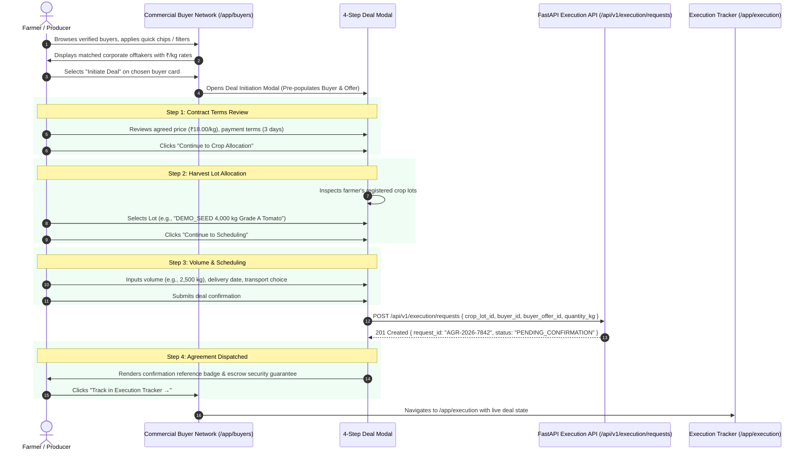

# AGRI2VALUE — COMMERCIAL BUYER NETWORK DATA & FLOW ARCHITECTURE

**System Scope:** Phase 3 Commercial Procurement, Contract Negotiation, and Order Dispatch  
**Target Route:** `/app/buyers`  
**Execution Target:** `/app/execution`  
**Date:** November 7, 2026

---

## 1. Data Schema & Contracts

### 1.1. Commercial Buyer Entity (`Buyer`)
```typescript
export interface Buyer {
  id: string;                     // e.g. "BUYER-001"
  name: string;                   // Corporate Entity Name
  buyer_type: 'PROCESSOR' | 'RETAIL_CHAIN' | 'EXPORTER' | 'WHOLESALER' | 'INSTITUTIONAL';
  district: string;               // District in Maharashtra (e.g., "Nashik", "Pune")
  state: string;                  // "Maharashtra"
  rating: number;                 // 1.0 to 5.0 (e.g. 4.9)
  trades_completed: number;       // Verified transactions completed
  distance_km: number;            // Distance from farmer's registered GPS
  is_verified: boolean;           // Verified corporate status flag
  verification_badge: string;     // e.g. "VERIFIED_COOPERATIVE", "CORPORATE_ESCROW"
  payment_sla_days: number;       // Payment settlement time (e.g. 3 days)
  procurement_yard: string;       // Physical delivery / yard location
  contact_person: string;         // Procurement officer name
  contact_phone: string;          // Official contact phone
  contact_email: string;          // Official procurement email
  cin_or_reg: string;             // Legal corporate registration
  active_offers: BuyerOffer[];    // Current active procurement contracts
}
```

### 1.2. Buyer Procurement Offer Entity (`BuyerOffer`)
```typescript
export interface BuyerOffer {
  id: string;                     // e.g. "OFFER-001"
  buyer_id: string;               // Foreign Key linking to Buyer
  commodity: string;              // Crop commodity (e.g., "Tomato")
  variety: string;                // Produce variety (e.g., "Abhinav / Commercial Red")
  quality_grade_required: string; // e.g. "Grade A, B"
  offered_price_per_kg: number;   // e.g. 18.00
  benchmark_diff: number;         // e.g. +3.50 over APMC modal rate
  min_quantity_kg: number;        // e.g. 1,000 kg
  max_quantity_kg: number;        // e.g. 25,000 kg
  pricing_type: 'FIXED' | 'MINIMUM_GUARANTEE' | 'APMC_PLUS';
  payment_terms_days: number;     // e.g. 3 days
  procurement_terms: string;      // e.g. "Fixed Yard Gate delivery, weightment on arrival"
  logistics_provided: boolean;    // Whether buyer provides transit pickup
  valid_until: string;            // ISO Date
}
```

---

## 2. Deal Initiation & Execution Request Flow



---

## 3. Resilience, Offline Fallback & Security

1. **Authentication Interceptor:**
   `frontend/src/api.ts` queries the backend with JWT authorization tokens. If unauthenticated, it seamlessly falls back to the rich `MOCK_BUYERS` dataset without crashing the client interface.
2. **Escrow Guarantee:**
   All corporate buyers are flagged with verified escrow backing (`Phase 3 Institutional Escrow`), ensuring that when a farmer dispatches an agreement, payments are contractually held in settlement custody.
3. **Data Parity with Profit Decision Engine:**
   Offered rates in the buyer network directly correspond to the commercial offtake pathway in the Profit Decision Engine (`₹18.00/kg` for `Sahyadri Agro Processing`), creating a cohesive, end-to-end product experience.
