# AGRI2VALUE — SMART EXECUTION TRACKER DATA & FLOW ARCHITECTURE

**System Scope:** Phase 3 Agricultural Transaction Monitoring, In-Transit Logistics, and Realized Payout Settlement  
**Target Route:** `/app/execution`  
**Date:** November 7, 2026

---

## 1. Data Schemas & State Contracts

### 1.1. Execution Request Entity (`ExecutionRequest`)
```typescript
export interface ExecutionRequest {
  id: string;                         // e.g. "exec-canonical-001"
  crop_lot_id: string;                // FK to registered crop lot
  farmer_user_id: string;             // Authenticated farmer
  decision_run_id?: string;           // Optional linkage to Profit Decision Engine
  route_type: string;                 // "PROCESSING" | "COMMERCIAL_OFFTAKE" | "DIRECT_DELIVERY" | "COLD_STORAGE"
  status: 'SUBMITTED' | 'PROVIDER_ACCEPTED' | 'CONFIRMED' | 'IN_EXECUTION' | 'COMPLETED' | 'CANCELLED' | 'REJECTED';
  buyer_id?: string;                  // FK to Buyer
  buyer_offer_id?: string;            // FK to BuyerOffer
  logistics_provider_id?: string;     // FK to LogisticsProvider
  cold_storage_facility_id?: string;  // FK to ColdStorageFacility
  processing_facility_id?: string;    // FK to ProcessingFacility
  requested_quantity_kg: number;      // Allocated volume
  indicative_unit_price: number;      // Pre-trade price (₹/kg)
  indicative_total_value: number;     // Gross value (Volume × Unit Price)
  indicative_logistics_cost: number;  // Estimated freight deduction
  indicative_storage_cost: number;    // Estimated cold holding tariff
  indicative_processing_cost: number; // Estimated processing charge
  indicative_net_payout: number;      // Net farmer payout projection
  actual_quantity_kg?: number;        // Certified net weighbridge quantity
  actual_unit_price?: number;         // Settled commercial rate
  actual_gross_revenue?: number;      // Realized gross value
  actual_logistics_cost?: number;     // Realized freight invoice
  actual_storage_cost?: number;       // Realized holding fee
  actual_processing_cost?: number;    // Realized processing charge
  actual_net_payout?: number;         // Final realized bank payout
  completion_notes?: string;          // Weighbridge & settlement details
  completed_at?: string;              // ISO timestamp of completion
  pickup_location: string;            // Origin farmgate
  delivery_location: string;          // Destination yard/plant
  scheduled_date?: string;            // Agreed service date
  notes?: string;                     // Special instructions
  data_mode: string;                  // "demo" | "live"
  created_at: string;
  updated_at: string;
  events: ExecutionRequestEvent[];    // Immutable audit trail
}
```

### 1.2. Execution Request Event Entity (`ExecutionRequestEvent`)
```typescript
export interface ExecutionRequestEvent {
  id: string;                         // e.g. "evt-001"
  request_id: string;                 // FK linking to parent ExecutionRequest
  from_status?: string;               // Previous lifecycle state
  to_status: string;                  // Advanced lifecycle state
  actor_role: string;                 // "FARMER" | "BUYER" | "PROCESSOR" | "LOGISTICS" | "SYSTEM" | "SETTLEMENT"
  message: string;                    // Audit trail log explanation
  metadata_json?: string;             // Optional JSON payload
  created_at: string;                 // Immutable ISO timestamp
}
```

---

## 2. 9-Stage Comprehensive Execution State Machine

```mermaid
stateDiagram-v2
    [*] --> SUBMITTED: Farmer submits deal or booking
    SUBMITTED --> PROVIDER_ACCEPTED: Offtaker/facility confirms availability
    SUBMITTED --> REJECTED: Provider unable to accept
    PROVIDER_ACCEPTED --> CONFIRMED: Farmer confirms; escrow lock engaged
    PROVIDER_ACCEPTED --> CANCELLED: Farmer cancels
    CONFIRMED --> IN_EXECUTION: Consignment loaded & en-route
    CONFIRMED --> CANCELLED: Pre-dispatch cancellation
    IN_EXECUTION --> COMPLETED: Delivery verified, weighbridge slip reconciled & RTGS paid
    COMPLETED --> [*]
    CANCELLED --> [*]
    REJECTED --> [*]
```



### Stage Details:
1. **Stage 1: Enquiry Submitted (`SUBMITTED`)** — Order registered in execution ledger.
2. **Stage 2: Provider Accepted (`PROVIDER_ACCEPTED`)** — Counterparty accepts terms.
3. **Stage 3: Booking Confirmed (`CONFIRMED`)** — Commercial terms locked; escrow safety engaged.
4. **Stage 4: Harvest / Pickup (`HARVEST_READY`)** — Farmgate crates prepared for loading.
5. **Stage 5: In Transit (`IN_EXECUTION`)** — Vehicle transit active along corridor.
6. **Stage 6: Processing / Delivery (`DELIVERY_ARRIVED`)** — Consignment arrives at gate dock.
7. **Stage 7: Weighbridge & Quality (`WEIGHBRIDGE_VERIFIED`)** — Tare-deducted weight verified.
8. **Stage 8: Financial Settlement (`SETTLEMENT_RECONCILED`)** — Actual deductions audited.
9. **Stage 9: Completed (`COMPLETED`)** — Realized payout credited to farmer bank account.

---

## 3. Financial Reconciliation & Variance Mathematics

### Indicative Pre-Trade Net Payout (Estimate)
$$\text{Indicative Net Payout} = \text{Indicative Gross} - (\text{Logistics}_{\text{est}} + \text{Storage}_{\text{est}} + \text{Processing}_{\text{est}})$$

### Actual Realized Net Payout (Outcome)
$$\text{Actual Net Payout} = (\text{Actual Qty} \times \text{Settled Rate}) - (\text{Logistics}_{\text{act}} + \text{Storage}_{\text{act}} + \text{Processing}_{\text{act}})$$

### Variance Analysis
$$\text{Variance Amount} = \text{Actual Net Payout} - \text{Indicative Net Payout}$$

$$\text{Variance Percentage} = \left( \frac{\text{Variance Amount}}{\text{Indicative Net Payout}} \right) \times 100\%$$
