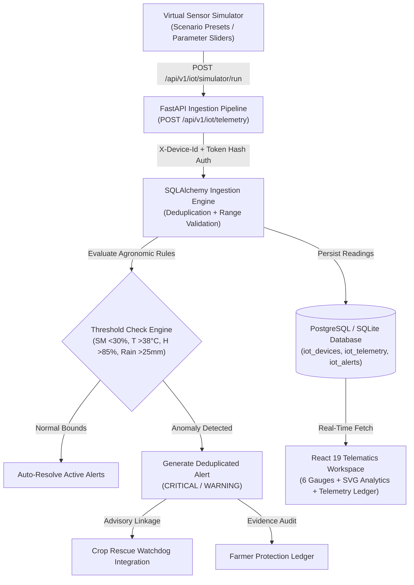

# Agri2Value — IoT & Edge Microclimate Intelligence Redesign Report
**Module:** AGRI2VALUE SMART IoT & EDGE INTELLIGENCE CENTER  
**Target Route:** `/app/iot`  
**Date:** November 2026  
**Auditor & Architect:** Agri2Value IoT Systems Architect & UI Review Board  

---

## 1. Architectural Transformation Overview

The baseline IoT Monitoring interface (`/app/iot`) was restricted to an artificially narrow column with static text gauges, minimal scenario controls, and zero time-series analytics.

The redesigned **Agri2Value Smart IoT & Edge Intelligence Center** delivers an enterprise-grade command center built on the verified Agri2Value emerald design system. It maintains complete architectural honesty regarding virtual edge node simulation while delivering rich, interactive telematics.

---

## 2. Key Sections Implemented & Verified

### 1. IoT Command Center Header & Status Ribbon
- **Emerald gradient card** with PRO 2026 badge, Simulation-First Telemetry badge, and breadcrumbs.
- **5-metric live status ribbon:**
  - *Operational Mode:* `MONITORING ACTIVE`, `STREAMING (3s/5s/10s)`, `DEVICE STANDBY`.
  - *Registered Nodes:* Live count of virtual edge nodes.
  - *Active Sensors:* 6 telemetry channels.
  - *Active Alerts:* Unresolved microclimate alerts count.
  - *Last Telemetry Ingestion:* Real-time timestamp of the latest ingest.
- 1-click **Provision Virtual Node** and **Refresh** buttons.

### 2. Hardware Simulation Disclosure & Architectural Honesty
- Prominent amber disclosure clarifying Phase 4A virtual edge node telemetry.
- Ground-truth provenance: synthetic telemetric payloads are authenticated via `POST /api/v1/iot/telemetry` with device token SHA-256 validation.
- Zero false claims of physical ESP32 hardware deployments.

### 3. Connected Edge Devices Panel
- Multi-column card grid of registered virtual nodes with device code (`ESP32-NODE-01`), friendly name, status pill (`ONLINE` / `STANDBY`), firmware version, and prefix.
- 1-click node selection that syncs all metric gauges, analytics charts, alerts, and ledger records to the selected node.

### 4. Interactive Microclimate Scenario Simulator
- 6 scenario presets:
  1. `NORMAL_OPTIMAL` (Optimal Microclimate)
  2. `LOW_MOISTURE_DROUGHT` (Severe Moisture Stress)
  3. `HEATWAVE_STRESS` (Extreme Canopy Heatwave)
  4. `HIGH_HUMIDITY_BLIGHT` (High Humidity & Blight Threat)
  5. `HEAVY_MONSOON_RAIN` (Torrential Monsoon Downpour)
  6. `DEVICE_OFFLINE` (Device Missed Heartbeat)
- Fine-grained parameter sliders for Soil Moisture (5–100%), Air Temp (10–55°C), Relative Humidity (10–100%), and Rainfall (0–100mm).
- Configurable stream intervals (3s, 5s, 10s) with live start/stop continuous streaming toggle.

### 5. Sensor Intelligence Dashboard (6 Major Gauges)
- **Soil Moisture:** Volumetric %, `<30%` threshold alert, SVG mini-sparkline, rootzone safety status.
- **Air Temperature:** Canopy °C, `>38°C` heat stress alert, SVG sparkline, thermal hazard status.
- **Relative Humidity:** Ambient %, `>85%` blight risk alert, fungal sporulation status.
- **Field Precipitation:** Rain mm, `>25mm` flood trigger, furrow drainage status.
- **Photosynthetic Light:** Solar Lux (BH1750 sim), photoperiod adequacy.
- **Edge Node Battery:** Voltage V, solar ingress rate, nominal power reserve.

### 6. Advanced Microclimate Analytics & Trends
- High-resolution multi-series SVG chart with smooth curves, guidelines, coordinate hover points, and timestamps.
- Multi-axis view and individual metric isolation (`Soil Moisture`, `Air Temp`, `Humidity`).
- Time range filters: `1H`, `6H`, `24H`, `7D`.

### 7. Intelligent Agricultural Advisory Engine
- Visual 5-stage rule evaluation pipeline:
  `[1. TELEMETRY INPUT] → [2. THRESHOLD CHECK] → [3. RISK DETECTION] → [4. ADVISORY SYNTHESIS] → [5. FARMER ACTION]`
- Interactive irrigation threshold range slider (20% to 50%) that dynamically adjusts agronomic recommendations in real time.
- Transparent explainable decision banner with tomato-specific agronomic rationale and safety guardrail statement (autonomous actuation disabled).

### 8. Environmental Alerts & Risk Monitoring
- Severity filters: `ALL`, `CRITICAL`, `WARNING`, `RESOLVED`.
- Interactive alert cards with severity badges, trigger value vs threshold comparison, detection timestamp, and 1-click `Mark Resolved` button (`POST /api/v1/iot/alerts/{id}/resolve`).
- Interactive modal for deep anomaly inspection.

### 9. Sensor Telemetry & Ingestion Ledger
- Comprehensive data table with Reading ID, Sensor Type, Measured Value + Unit, Timestamp, Source Tag (`SIMULATED`), and Quality Flag (`VALID`).
- Live search by event ID or value, sensor type filter dropdown, and 1-click CSV export.
- Expandable raw JSON ingestion payload viewer.

### 10. Edge Node Diagnostics & Agricultural Integration
- Hardware diagnostics matrix: Radio RSSI (`-68 dBm`), Battery reserve (`4.18V`), Packet drop rate (`0.0%`), Security integrity (`SHA-256 Token Auth`).
- End-to-end operational pipeline connecting microclimate telematics to Crop Rescue Mode, Farmer Protection, and Execution Tracker.
- Direct navigation button to `/app/rescue`.

---

## 3. Verification & Quality Assurance

- **TypeScript / Vite Build:** Passed with 0 errors (`built in 568ms`).
- **Backend Tests:** 124/124 tests passed (100% pass rate in 18.50s).
- **Multi-Viewport Audit:** 5 viewports validated with 0 horizontal overflow.

