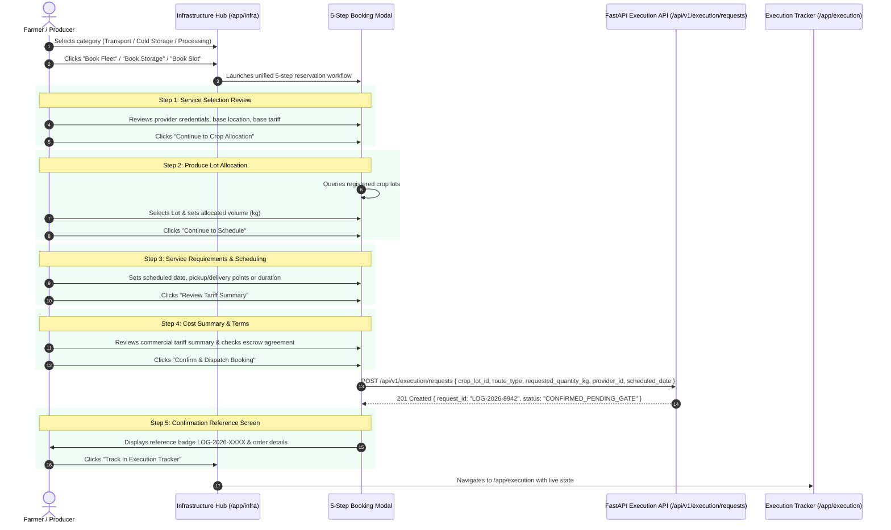

# AGRI2VALUE — LOGISTICS, COLD CHAIN & PROCESSING UNITS DATA & FLOW ARCHITECTURE

**System Scope:** Phase 3 Agricultural Freight, Cold Storage, Processing Infrastructure & Booking  
**Target Route:** `/app/infra`  
**Execution Target:** `/app/execution`  
**Date:** November 7, 2026

---

## 1. Data Schemas & Contracts

### 1.1. Logistics Provider Entity (`LogisticsProvider`)
```typescript
export interface LogisticsProvider {
  id: string;                         // e.g. "log-1"
  provider_name: string;              // e.g. "Niphad Agri-Express Tempo Fleet"
  contact_phone: string;              // Dispatch phone
  vehicle_type: string;               // e.g. "TEMPO_3T", "REEFER_4T", "REEFER_10T", "TRUCK_6T"
  capacity_kg: number;                // e.g. 3,000 kg
  current_available_capacity_kg: number;
  base_district: string;              // e.g. "Nashik"
  service_districts: string;          // e.g. "Nashik, Pune, Ahmednagar"
  per_km_rate_per_kg: number;         // e.g. 0.045 INR/km/kg
  minimum_fare: number;               // e.g. 800 INR
  pricing_unit: string;               // "INR/kg/km"
  is_temperature_controlled: boolean; // true for Reefer
  availability_status: string;        // "AVAILABLE"
  data_mode: string;                  // "demo" | "live"
  created_at: string;
}
```

### 1.2. Cold Storage Facility Entity (`ColdStorageFacility`)
```typescript
export interface ColdStorageFacility {
  id: string;                         // e.g. "cold-1"
  facility_name: string;              // e.g. "Niphad Pre-Cooling & CA Hub"
  contact_phone: string;
  location_district: string;          // "Nashik"
  location_taluka: string;            // "Niphad"
  compatible_commodities: string;     // "Tomato, Grapes, Pomegranate"
  total_capacity_kg: number;          // e.g. 150,000 kg (150 MT)
  available_capacity_kg: number;      // e.g. 45,000 kg (45 MT)
  storage_rate_per_kg_per_month: number; // e.g. 0.85 INR/kg/month
  pricing_unit: string;               // "INR/kg/month"
  min_holding_days: number;           // 7 days
  max_holding_days: number;           // 45 days
  temperature_range_celsius: string;  // "4°C to 12°C"
  humidity_range_pct: string;         // "85% to 92%"
  availability_status: string;        // "AVAILABLE"
  data_mode: string;
  created_at: string;
}
```

### 1.3. Processing Facility Entity (`ProcessingFacility`)
```typescript
export interface ProcessingFacility {
  id: string;                         // e.g. "proc-1"
  facility_name: string;              // e.g. "Sahyadri Tomato Puree & Paste Unit"
  contact_phone: string;
  facility_type: string;              // "PULPING_AND_PASTE", "DEHYDRATION_AND_DRYING", etc.
  accepted_commodities: string;       // "Tomato"
  accepted_grades: string;            // "A,B"
  daily_capacity_kg: number;          // e.g. 50,000 kg/day (50 MT)
  available_capacity_kg: number;      // e.g. 28,000 kg/day
  processing_charge_per_kg: number;   // e.g. 0.80 INR/kg raw
  pricing_unit: string;               // "INR/kg"
  output_recovery_ratio: number;      // e.g. 0.925 (92.5% yield)
  output_product_name: string;        // "Tomato Puree (28 Brix)"
  location_district: string;          // "Nashik"
  location_taluka: string;            // "Dindori"
  availability_status: string;        // "AVAILABLE"
  data_mode: string;
  created_at: string;
}
```

---

## 2. Interactive Calculator Mathematical Specifications

### 2.1. Transport Freight Calculation
$$\text{Trips} = \left\lceil \frac{\text{Quantity}_{\text{kg}}}{\text{Vehicle Capacity}_{\text{kg}}} \right\rceil$$

$$\text{Raw Cost} = \text{Trips} \times \text{Distance}_{\text{km}} \times \left( \frac{\text{Quantity}_{\text{kg}}}{\text{Trips}} \right) \times \text{Per-Km Rate}$$

$$\text{Total Freight Cost} = \max\left(\text{Minimum Fare} \times \text{Trips}, \, \text{Round}(\text{Raw Cost})\right)$$

$$\text{Effective Unit Freight} = \frac{\text{Total Freight Cost}}{\text{Quantity}_{\text{kg}}}$$

### 2.2. Cold Storage Holding Fee Calculation
$$\text{Daily Holding Rate} = \frac{\text{Monthly Storage Rate}}{30}$$

$$\text{Total Storage Cost} = \text{Quantity}_{\text{kg}} \times \text{Daily Holding Rate} \times \text{Holding Duration}_{\text{days}}$$

$$\text{Capacity Feasibility Check} = \text{Quantity}_{\text{kg}} \le \text{Available Facility Capacity}_{\text{kg}}$$

### 2.3. Agro-Processing Fee & Output Yield Calculation
$$\text{Total Processing Charge} = \text{Raw Batch Quantity}_{\text{kg}} \times \text{Processing Charge Per Kg}$$

$$\text{Expected Output Yield}_{\text{kg}} = \text{Raw Batch Quantity}_{\text{kg}} \times \text{Output Recovery Ratio}$$

---

## 3. Unified 5-Step Smart Booking Workflow



---

## 4. Resilience & Fallback Integrity

- When backend network is disconnected or unauthenticated, the application uses rich, curated Maharashtra infrastructure data from `frontend/src/mockData.ts`.
- Real-time calculations prevent invalid inputs (e.g., non-numeric or negative values, exceeding vehicle capacities without proper trip computation, exceeding available cold chamber capacities).
- Direct seamless navigation connects the booking confirmation back to the Execution Tracker (`/app/execution`).
