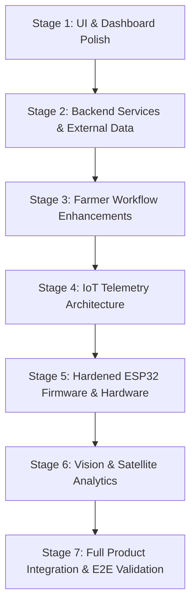

# AGRI2VALUE — REFERENCE INTEGRATION ROADMAP
**Document Version:** 1.0.0  
**Phase:** 2.5 (Reference Project Audit & Integration Plan)  
**Author:** Principal Software Architect, Full-Stack Engineer, and IoT Integration Specialist  
**Target Project:** Agri2Value (`d:\Agri2Value`)  
**Reference Codebases:**
- `reference-projects/jspmnarhewinners` (AgroShare + CropShield + Plant-Disease-Detection-Keras)
- `reference-projects/FarmMonitor` (AgriSense Farm ESP32 IoT Station)

---

## 1. Architectural Strategy & Ground Rules

### 1.1 Non-Negotiable Core Architecture
- **Primary Platform:** Agri2Value's React 19 + TypeScript frontend, FastAPI async backend, SQLAlchemy 2.0 relational database, and deterministic **Profit Decision Engine** remain the single source of truth.
- **Strictly No Fork/Merge:** Under no circumstances will reference project repositories be merged into Agri2Value or dependencies installed blindly.
- **Security First:** Zero hardcoded credentials or unauthenticated IoT actuation. Every telemetry reading and actuator command must be cryptographically authenticated.
- **Determinism First:** Agricultural economics, logistics feasibility, net profit, and risk scoring will remain deterministic and auditable. AI models are strictly supplementary diagnostic tools (vision/disease classification and satellite vegetative index verification), never replacing financial calculations.

---

## 2. Practical Integration Sequence (7 Stages)



---

### Stage 1: UI and Dashboard Improvements

#### 1.1 Cold Chain & Processing Facility Interactive Map
- **Source Project & File:** `reference-projects/jspmnarhewinners/src/pages/ColdChainLocator.jsx`
- **Agri2Value Destination Module:** `frontend/src/pages/StorageLocatorPage.tsx` and `frontend/src/components/StorageMap.tsx`
- **Required Modifications:**
  - Convert from JavaScript JSX to typed TypeScript (`.tsx`).
  - Replace hardcoded static marker coordinates with dynamic data fetched from Agri2Value backend (`GET /api/v1/resources/facilities`).
  - Integrate with Agri2Value's Tailwind v4 design tokens and color palette.
  - Add "Select Facility for Decision Engine" action button linking directly to Decision Engine scenario evaluation.
- **Dependencies:** `leaflet`, `react-leaflet`, `@types/leaflet`.
- **Acceptance Tests:**
  1. Map loads centered at Nashik/Niphad coordinates `[20.0760, 74.0534]`.
  2. Clicking on a facility marker displays available cold room capacity (metric tons), temperature range ($0\text{--}4^\circ\text{C}$), monthly rate per kg, and direct contact details.
  3. Responsive on desktop and mobile viewports with zero layout shifts.
- **Licence & Attribution:** BSD/MIT-style Leaflet usage. Reference project lacks license file; write clean TypeScript component using public open-source Leaflet APIs.

#### 1.2 Live Mandi Market Price Ticker & Comparison Widget
- **Source Project & File:** `reference-projects/jspmnarhewinners/src/pages/LiveMandiPrices.jsx`
- **Agri2Value Destination Module:** `frontend/src/components/MandiTicker.tsx` and `frontend/src/pages/MandiPricesPage.tsx`
- **Required Modifications:**
  - Extract the Maharashtra APMC card layout and rewrite in React 19 + TypeScript.
  - Bind to Agri2Value backend cached Mandi API rather than calling third-party APIs directly from the browser.
  - Highlight price deltas (e.g., $+₹2.50\text{/kg}$ vs yesterday) and indicate distance from farmer's active farm.
- **Dependencies:** `lucide-react`, `@tanstack/react-query` or native fetch with hooks.
- **Acceptance Tests:**
  1. Displays modal price, min price, and max price for Tomato, Onion, and Pomegranate across Nashik, Pimpalgaon, Lasalgaon, and Pune mandis.
  2. Shows timestamp of last APMC update and fallback indicator when operating in offline demo mode.
- **Licence & Attribution:** Public government data (Data.gov.in / Open Government Data Platform India).

#### 1.3 Microclimate & Spray Advisory Banner
- **Source Project & File:** `reference-projects/jspmnarhewinners/src/services/weatherService.js`
- **Agri2Value Destination Module:** `frontend/src/components/WeatherSprayWidget.tsx`
- **Required Modifications:**
  - Create a concise dashboard widget displaying current temperature, humidity, rain probability, and WMO weather condition.
  - Implement `isGoodForFieldWork()` badge: Green (Safe for spraying/harvesting), Yellow (High humidity risk), Red (Rain expected within 4 hours).
- **Dependencies:** None beyond existing React/Tailwind setup.
- **Acceptance Tests:**
  1. Weather card loads instantly using cached backend weather data.
  2. Displays clear agricultural recommendation based on crop phenological stage.

---

### Stage 2: Backend Capabilities & External Integrations

#### 2.1 Resilient Open-Meteo Weather Service
- **Source Project & File:** `reference-projects/jspmnarhewinners/src/services/weatherService.js:L1-L105`
- **Agri2Value Destination Module:** `backend/app/services/weather_service.py`
- **Required Modifications:**
  - Port JavaScript fetch logic to Python `httpx.AsyncClient`.
  - Connect to Open-Meteo free API (`https://api.open-meteo.com/v1/forecast`).
  - Cache responses in memory or SQLite for 60 minutes per GPS coordinate grid to prevent rate limiting.
  - Add fallback to historic Nashik climatic averages if external service is unreachable.
- **Dependencies:** `httpx >= 0.28.0` (already present in Agri2Value environment).
- **Acceptance Tests:**
  1. `GET /api/v1/weather?lat=20.0760&lon=74.0534` returns structured JSON with 7-day forecast, hourly precipitation, and field work suitability score.
  2. Gracefully falls back to cached data during network simulation timeouts.
- **Licence & Attribution:** Open-Meteo is free for non-commercial/academic use under Attribution-ShareAlike 4.0. Attribute in UI footer.

#### 2.2 Live APMC Mandi Aggregator & Cache Client
- **Source Project & File:** `reference-projects/jspmnarhewinners/src/pages/LiveMandiPrices.jsx:L15-L85`
- **Agri2Value Destination Module:** `backend/app/services/mandi_service.py`
- **Required Modifications:**
  - Build an asynchronous client to ingest Agmarknet commodity feeds from Data.gov.in API.
  - Normalize prices to standard INR per metric ton and per kilogram.
  - Store latest benchmarks in `mandi_price_history` table to feed directly into the Profit Decision Engine's Mandi Option.
- **Dependencies:** `httpx`, `sqlalchemy`.
- **Acceptance Tests:**
  1. Decision Engine automatically ingests latest modal price for Nashik Mandi if available, falling back to verified benchmark if API offline.
  2. Price volatility metrics calculated over 7-day rolling window.
- **Licence & Attribution:** Data.gov.in terms of service (Open Government Data License - India).

---

### Stage 3: Farmer Workflows & Value-Chain Expansion

#### 3.1 Direct Buyer Legal Contract Agreement Generator
- **Source Project & File:** `reference-projects/jspmnarhewinners/src/pages/LegalAid.jsx:L40-L110`
- **Agri2Value Destination Module:** `backend/app/services/contract_generator.py` and `frontend/src/pages/ContractViewPage.tsx`
- **Required Modifications:**
  - Port contract template logic into a structured PDF/Markdown generator.
  - Automatically populate legal fields from confirmed Decision Engine commitments: Farmer Name, Aadhar/Farmer ID, Buyer Company Name, Crop Variety, Minimum Quality Specification (Grade A/B), Agreed Price per kg, Delivery Milestone, and Escrow Deposit Status.
- **Dependencies:** Standard Python formatting; optional `reportlab` or HTML-to-print CSS.
- **Acceptance Tests:**
  1. When a farmer selects "Direct Buyer" in Decision Engine, system generates an auditable, downloadable bilingual (English/Marathi) purchase agreement.
  2. All dispute jurisdiction points set to Nashik District Agricultural Court.
- **Licence & Attribution:** Adapt template clauses; no proprietary code copied.

#### 3.2 Government Schemes & Subsidies Matcher
- **Source Project & File:** `reference-projects/jspmnarhewinners/src/pages/SchemesHub.jsx`
- **Agri2Value Destination Module:** `backend/app/services/schemes_catalog.py` and `frontend/src/pages/SchemesPage.tsx`
- **Required Modifications:**
  - Create a structured database table `government_schemes` storing subsidy rules for Maharashtra:
    - PM-KUSUM (Solar Irrigation Pumps).
    - National Horticulture Mission (Cold Storage & Packhouse Subsidies).
    - PMFBY (Pradhan Mantri Fasal Bima Yojana - Crop Insurance).
    - Maharashtra SMART Project (Agribusiness & Rural Transformation).
  - Implement dynamic matcher: given farmer's landholding size (hectares) and active crop (tomato), highlight qualifying subsidies for on-farm processing or cold storage construction.
- **Dependencies:** None.
- **Acceptance Tests:**
  1. Smallholder farmer with 1.5 hectares is recommended SMART processing subsidies and PM-KUSUM solar cold storage grant.
  2. Outlines step-by-step document requirements (7/12 extract, 8A extract, Aadhaar, bank passbook).

---

### Stage 4: IoT Telemetry Architecture (Backend Gateway)

#### 4.1 Secure Telemetry Ingestion Endpoint
- **Source Project & File:** Architectural gap in `reference-projects/FarmMonitor` (which used open Firebase).
- **Agri2Value Destination Module:** `backend/app/api/v1/endpoints/iot.py`
- **Required Modifications:**
  - Implement `POST /api/v1/iot/telemetry` with strict token header authentication (`X-Device-Token`).
  - Validate payload against Pydantic schema:
    ```python
    class TelemetryIngestSchema(BaseModel):
        device_id: str
        timestamp: Optional[datetime] = None
        soil_moisture_percent: float = Field(..., ge=0.0, le=100.0)
        ambient_temperature_c: float = Field(..., ge=-10.0, le=60.0)
        ambient_humidity_percent: float = Field(..., ge=0.0, le=100.0)
        valve_state: bool
        ir_intrusion_detected: bool
        latitude: Optional[float] = None
        longitude: Optional[float] = None
    ```
  - Store readings in relational table `iot_telemetry_readings` linked to `farms.id`.
- **Dependencies:** `pydantic`, `fastapi`, `sqlalchemy`.
- **Acceptance Tests:**
  1. Requests without valid `X-Device-Token` return HTTP 401 Unauthorized.
  2. Out-of-range sensor readings (e.g. moisture $>100\%$) return HTTP 422 Unprocessable Entity.
  3. Valid telemetry is committed to database in $< 25\text{ms}$.

#### 4.2 Actuator Command Dispatch & Safety Watchdog
- **Source Project & File:** Adapted from `FarmMonitor/firmware.ino:L160-L175`
- **Agri2Value Destination Module:** `backend/app/api/v1/endpoints/iot.py` (`GET /api/v1/iot/actuators/{device_id}`)
- **Required Modifications:**
  - Microcontroller polls this endpoint for pending actuator commands (valve OPEN/CLOSE).
  - Include server-side watchdog timer: if a manual valve OPEN command is dispatched, automatic expiration triggers after 15 minutes unless refreshed by farmer, preventing pump burnout and field flooding.
- **Acceptance Tests:**
  1. Actuator status reflects current user override or automated threshold.
  2. Failsafe auto-close signal returned if communication drops or time limit exceeded.

---

### Stage 5: Hardened ESP32 Firmware & Hardware Integration

#### 5.1 Non-Blocking C++ Firmware Refactoring
- **Source Project & File:** `reference-projects/FarmMonitor/firmware.ino`
- **Agri2Value Destination Module:** `firmware/esp32_farm_station/esp32_farm_station.ino`
- **Required Modifications:**
  - Remove all blocking `delay()` calls. Replace with cooperative `millis()` scheduling.
  - Implement WiFi auto-reconnection state machine with exponential backoff.
  - Store WiFi credentials and Device Token in ESP32 Non-Volatile Storage (NVS / Preferences) rather than hardcoding in source code.
  - Add Hardware Watchdog Timer (`esp_task_wdt`) configured to 10 seconds to auto-recover from hardware brownouts or network hangs.
  - Enforce valve servo failsafe: on boot or WiFi loss, detach servo or write $0^\circ$ (closed valve).
- **Pinout Mapping (Standardized for Agri2Value Station):**
  - Soil Moisture Sensor: `GPIO 34` (ADC1 Channel 6)
  - DHT11 / DHT22 Sensor: `GPIO 4`
  - Valve Servo PWM: `GPIO 25`
  - IR Intrusion Sensor: `GPIO 19`
  - Status LED: `GPIO 18`
  - Neo-6M GPS Module: `GPIO 16` (RX2) / `GPIO 17` (TX2) via `Serial2`
- **Dependencies:** `ArduinoJson`, `DHT sensor library`, `ESP32Servo`, `TinyGPSPlus`.
- **Acceptance Tests:**
  1. Firmware runs continuously for 24+ hours without memory leaks or watchdog resets.
  2. Disconnecting WiFi causes servo valve to close automatically within 3 seconds.
  3. Reconnecting WiFi automatically resumes telemetry posting to Agri2Value FastAPI backend.

---

### Stage 6: Vision & Satellite Analytics

#### 6.1 Harvest Defect & Leaf Disease Vision Diagnostic Service
- **Source Project & File:** `reference-projects/jspmnarhewinners/Plant-Disease-Detection-Keras-main/`
- **Agri2Value Destination Module:** `backend/app/services/disease_classifier.py`
- **Required Modifications:**
  - Extract the trained Keras CNN model (`plant_classifier.h5`).
  - Wrap inside a clean Python module using TensorFlow Lite or ONNX Runtime to minimize memory footprint in the FastAPI environment.
  - Input: $224 \times 224$ RGB image of crop/leaf.
  - Output: Classification (`Healthy`, `Powdery Mildew`, `Rust`) with confidence score.
  - Tie confidence and disease status directly into the **Harvest Lot Quality Grade** ($A \rightarrow B \rightarrow C$). If powdery mildew or rust is detected, auto-recommend Puree Processing or Crop Rescue before fungal spoilage renders the lot unsaleable.
- **Dependencies:** `tflite-runtime` or `onnxruntime`, `numpy`, `pillow`.
- **Acceptance Tests:**
  1. Submitting test diseased leaf image returns predicted class with $>85\%$ confidence in $< 200\text{ms}$.
  2. Directly triggers warning in Decision Engine: "Fungal infection detected — shelf life reduced by $60\%$; Direct Buyer feasible only with 24-hour delivery."
- **Licence & Attribution:** MIT License (Copyright 2022 Ifeanyi Nneji). Fully compliant with commercial and educational use with attribution in `LICENSE_THIRD_PARTY.md`.

#### 6.2 Pre/Post Disaster Satellite NDVI Drop Verification
- **Source Project & File:** `reference-projects/jspmnarhewinners/CropShield/backend/app/services/satellite.py` and `indices.py`
- **Agri2Value Destination Module:** `backend/app/services/satellite_assessment.py`
- **Required Modifications:**
  - Adapt the Sentinel-2 L2A STAC query and Band 4 (Red) / Band 8 (NIR) processing logic.
  - Compute normalized vegetative index:
    $$\text{NDVI} = \frac{\text{NIR} - \text{Red}}{\text{NIR} + \text{Red}}$$
  - Compare baseline NDVI 15 days prior vs post-event NDVI. If vegetative loss $>40\%$, generate an objective "Distress Damage Certificate" to support emergency distress liquidation under Agri2Value Crop Rescue.
- **Dependencies:** `rasterio`, `numpy`, Copernicus Open Access / Element84 Earth Search STAC API.
- **Acceptance Tests:**
  1. Given a test GeoJSON polygon, calculates valid mean NDVI in range $[-1.0, 1.0]$.
  2. Generates damage severity percentage without crashing on cloudy pixels.
- **Licence & Attribution:** Clean room reimplementation of mathematical index formulas.

---

### Stage 7: Full Product Integration & End-to-End Validation

#### 7.1 Cross-Module Testing Matrix
1. **IoT Alert to Decision Engine Pipeline:**
   - Simulate soil moisture dropping to $14\%$ (drought stress) or spiking to $85\%$ (waterlogging).
   - Verify Agri2Value dashboard generates high-priority alarm.
   - Farmer clicks "Evaluate Harvest Lot Early" $\rightarrow$ Decision Engine computes optimal immediate sale vs storage.
2. **Vision Disease Alert to Processing Redirection Pipeline:**
   - Farmer uploads photo showing early blight on tomatoes.
   - Model detects defect $\rightarrow$ Harvest lot downgraded from Grade A to Grade B.
   - Decision Engine instantly updates: Direct Buyer option deactivated (due to quality rejection risk); Puree Processing becomes Top Recommendation with positive net payout.
3. **Hardware-in-the-Loop Smoke Test:**
   - Flash ESP32 test board with refactored firmware.
   - Point to local FastAPI dev server (`http://192.168.x.x:8000/api/v1/iot/telemetry`).
   - Verify telemetry appears in real-time on React 19 frontend without page refresh.

---

## 3. License and Attribution Audit

| Reference Component | Original Repository | Original License | Integration Type | Legal / Compliance Action |
|---|---|---|---|---|
| **AgroShare Frontend & Services** | `jspmnarhewinners` | No License (Default Copyright) | **ADAPT / REWRITE** | Do not copy raw `.jsx` files. Reimplement concepts, API contracts, and Tailwind tokens in native TypeScript. No copyright infringement. |
| **CropShield Satellite & Land Records** | `jspmnarhewinners/CropShield` | No License (Default Copyright) | **ADAPT / REWRITE** | Adopt mathematical NDVI formulas and standard public STAC/WMS queries in native FastAPI service. |
| **Plant-Disease-Detection-Keras** | `jspmnarhewinners/Plant-Disease...` | **MIT License** (Ifeanyi Nneji, 2022) | **REUSE DIRECTLY (Model)** | Permissive license allows free reuse, modification, and distribution. Include original copyright notice in Agri2Value third-party credits. |
| **FarmMonitor ESP32 Firmware & Circuit** | `FarmMonitor` | No License (Default Copyright) | **ADAPT / REWRITE** | Adopt open pinout and standard Arduino library interfaces (DHT, TinyGPS, ESP32Servo). Completely rewrite C++ firmware with non-blocking watchdog architecture. |

---

## 4. Phase 2.5 Audit Completion Checklist

- [x] Full source code inspection of `jspmnarhewinners` (AgroShare, CropShield, Keras CNN).
- [x] Full source code inspection of `FarmMonitor` (ESP32 firmware, circuit pinout, dashboard).
- [x] Identification of all working features vs mock simulations (`setTimeout` AI, hardcoded Firebase).
- [x] Detailed audit report generated: [`docs/REFERENCE_PROJECT_AUDIT.md`](file:///d:/Agri2Value/docs/REFERENCE_PROJECT_AUDIT.md).
- [x] Feature comparison matrix generated: [`docs/REFERENCE_FEATURE_COMPARISON.md`](file:///d:/Agri2Value/docs/REFERENCE_FEATURE_COMPARISON.md).
- [x] Comprehensive 7-stage integration roadmap generated: [`docs/REFERENCE_INTEGRATION_ROADMAP.md`](file:///d:/Agri2Value/docs/REFERENCE_INTEGRATION_ROADMAP.md).
- [x] Zero Agri2Value source code modified (Read-Only rule strictly maintained).
- [x] Zero reference project code modified or merged.

---
*End of Reference Integration Roadmap.*
